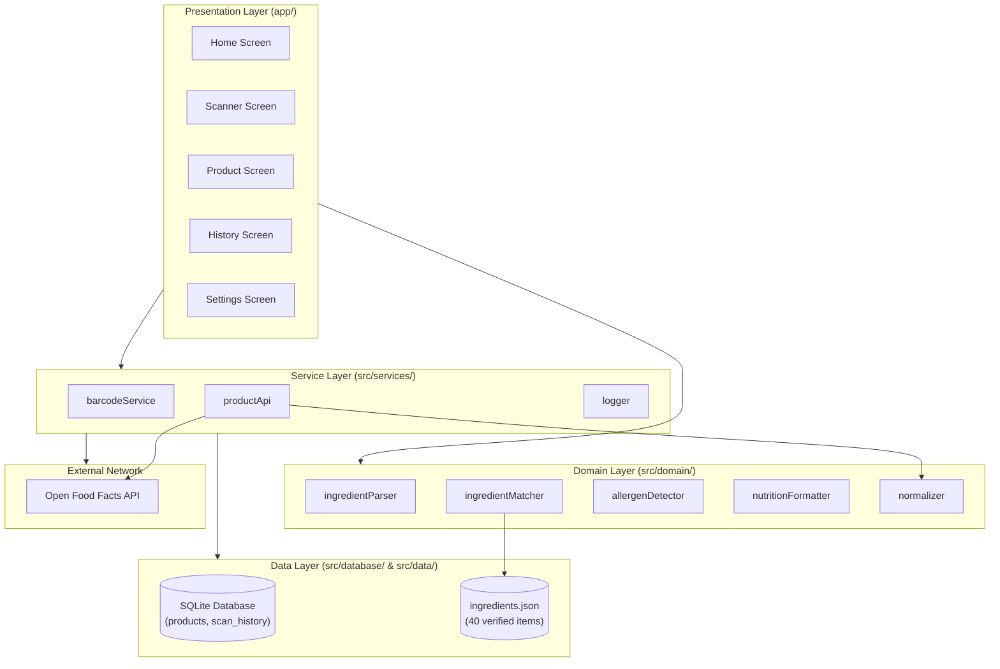

# System Architecture: Label Padho

## Overview
Label Padho uses a clean client-only architecture. The application runs entirely on the user device with React Native and Expo. There is no custom backend server. An external read-only API (Open Food Facts) provides product data when online, which is cached locally in SQLite. Pure domain logic handles ingredient parsing and allergen detection without external network dependencies.

## Tenancy
Single user per device. All state is stored in the local SQLite file on the device filesystem.

## Component Architecture

## Folder Responsibilities

- **app/**: Expo Router screens and layouts. Contains UI state and user event handling only. No business or parsing logic lives here.
- **src/domain/**: Pure TypeScript domain functions with zero React or Expo imports. Easily testable via Jest in Node environment.
  - `ingredientParser`: Splits ingredient lists respecting bracket nesting, commas, semicolons, and percentages.
  - `ingredientMatcher`: Matches parsed terms and INS codes against the local dictionary.
  - `allergenDetector`: Evaluates declared allergens into CONTAINS, MAY_CONTAIN, or NOT_DECLARED_IN_TEXT.
  - `nutritionFormatter`: Normalizes nutrition per 100 g and marks absent values as not available.
  - `normalizer`: Converts raw Open Food Facts payloads into typed internal Product objects.
- **src/services/**: External integration and platform bridges.
  - `productApi`: Fetches product JSON from Open Food Facts with timeouts and error wrapping.
  - `barcodeService`: Validates barcode check digits and debounces repeat scans.
  - `logger`: Structured logging interface without production console pollution.
- **src/database/**: `expo-sqlite` wrapper, migrations, and repositories for `products` and `scan_history`.
- **src/data/**: Static bundled `ingredients.json` dictionary.
- **src/types/**: TypeScript interfaces for Product, Ingredient, AllergenState, and Nutrition.
- **src/components/**: Minimal reusable presentational controls (buttons, cards, badges).
- **site/**: Independent static website deployed to Netlify (HTML/CSS only).

